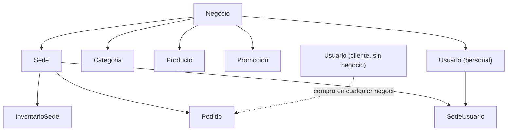
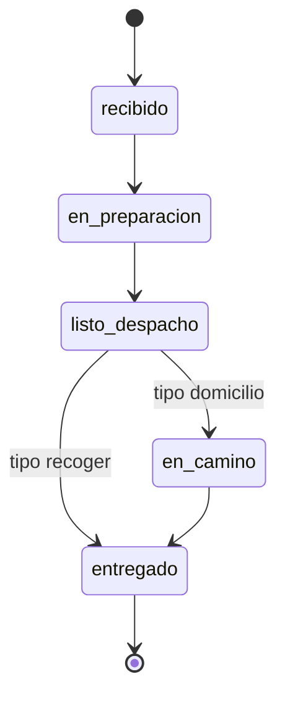

# DomiPedidosX: documentación del backend

Describe la arquitectura y los endpoints de la API REST. El código fuente está en `backend/`.

- **Stack:** Django, Django REST Framework (DRF), SimpleJWT, SQLite en local y PostgreSQL en despliegue (`DATABASE_URL`).
- **URL base:** `/api`. En local: `http://localhost:8000/api`.
- **Autenticación:** encabezado `Authorization: Bearer <access>`. El acceso por defecto exige sesión; cada vista pública lo declara con `AllowAny`.

## 1. Arquitectura

### 1.1 Capas

Cada dominio es una app en `backend/apps/` con la misma división de responsabilidades.

| Archivo | Responsabilidad |
|---|---|
| `models.py` | Tablas y reglas de una sola fila (`CheckConstraint`, `UniqueConstraint`) |
| `serializers.py` | Conversión a JSON y validación de formato |
| `views.py` | Vistas `APIView` delgadas: permisos, alcance y respuesta |
| `services.py` | Lógica de negocio y transacciones (`transaction.atomic`) |
| `urls.py` | Rutas de la app |
| `tests.py` | Pruebas con `APITestCase` |

Los permisos reutilizables están en `apps/core/permissions.py`.

| App | Dominio | ¿Tiene endpoints? |
|---|---|---|
| `negocios` | Modelo `Negocio` | No; se crea con el registro de negocio y se administra en el admin de Django |
| `usuarios` | Cuentas, JWT, personal, direcciones | Sí |
| `sedes` | Sedes y horarios | Sí |
| `menu` | Categorías, productos, opciones, combos | Sí |
| `inventario` | Disponibilidad y existencias por sede | Sí |
| `promociones` | Promociones con vigencia y cupo | Sí |
| `pedidos` | Pedidos, detalle e historial de estados | Sí |
| `notificaciones` | Alertas de stock bajo | No; las genera el descuento de inventario |
| `cobertura` | Zonas y capacidad por franja | No; solo modelos |
| `repartos`, `reportes` | Reservadas | No |

### 1.2 Modelo multi-negocio (multi-tenant)

Varios restaurantes comparten la misma base de datos y la misma API. **`Negocio` es el inquilino (tenant)**: cada restaurante ve y administra solo sus datos. El aislamiento es lógico, por filas y con la columna `negocio_id`; no hay una base de datos por negocio.



Reglas del modelo:

1. **Pertenencia directa:** `Sede`, `Categoria`, `Producto`, `Promocion` y `User` tienen la clave foránea `negocio_id`.
2. **Pertenencia indirecta:** `InventarioSede`, `Pedido`, `HorarioAtencion` y `SedeUsuario` pertenecen al negocio a través de su sede.
3. **Clientes compartidos:** un cliente tiene `negocio_id = NULL`. Una misma cuenta compra en cualquier negocio, y ningún negocio administra esa cuenta.
4. **Fallo cerrado:** personal sin negocio no ve ni crea nada. `exigir_negocio` responde 403 y los filtros por `negocio_id` devuelven vacío. Esto incluye a un superusuario creado con `createsuperuser`, que solo sirve para el admin de Django.
5. **Asignación en el servidor:** el `negocio` de un recurso nuevo sale siempre de `request.user`. Nunca se acepta en el cuerpo de la petición.
6. **Sin enlaces cruzados:** los servicios rechazan relacionar recursos de negocios distintos, como un producto ajeno en un combo o en una promoción.
7. **Negocio inactivo:** con `Negocio.activo = False` sus sedes, catálogo y promociones dejan de ser públicos. Hoy este campo solo se cambia desde el admin de Django.

### 1.3 Lectura pública y gestión privada

El menú es público para que los clientes puedan navegarlo. La gestión siempre queda limitada al negocio.

| Quién consulta | Sedes, categorías y productos en listados |
|---|---|
| Anónimo o cliente | Lo activo de negocios activos. Categorías, productos y combos admiten `?negocio=<id>` |
| Personal | Solo su propio negocio |

Al consultar por id, cualquiera puede ver un producto, categoría o combo activo, porque es menú abierto. Lo inactivo solo lo ve quien lo gestiona.

### 1.4 Registro de un negocio

`POST /api/usuarios/registro-negocio/` crea el negocio y su administrador en una sola transacción: se crean ambos o ninguno. El administrador recibe `rol=admin` e `is_staff=True`, sin permisos de superusuario. La respuesta no incluye tokens, así que después se debe iniciar sesión. El negocio nace sin sedes.

## 2. Permisos

### 2.1 Clases por rol

Definidas en `apps/core/permissions.py`. Exigen usuario autenticado y activo, y comparan `request.user.rol`, leído de la base de datos. **El claim `rol` del token nunca decide el acceso.** El administrador no tiene acceso implícito: cada vista lo incluye de forma explícita.

| Clase | Rol |
|---|---|
| `EsCliente` | `cliente` |
| `EsOperador` | `operador` |
| `EsCocina` | `cocina` |
| `EsRepartidor` | `repartidor` |
| `EsAdmin` | `admin` |

Se combinan con el operador de DRF, por ejemplo `EsOperador | EsAdmin`.

### 2.2 Alcance por negocio y sede

El rol dice qué puede hacer el usuario; el alcance dice sobre qué datos.

| Función | Comportamiento |
|---|---|
| `usuario_opera_en_sede(user, sede)` | El admin opera en todas las sedes de su negocio. El resto, solo en las asignadas en `SedeUsuario` |
| `usuario_puede_gestionar_sede(user, sede)` | Igual que la anterior, pero solo para admin y operador |
| `exigir_negocio(user)` | Devuelve el negocio del usuario o responde 403 |
| `exigir_operacion_sede(user, sede)` | 403 si el usuario no trabaja en la sede |
| `exigir_gestion_sede(user, sede)` | 403 si el usuario no gestiona la sede |
| `pedidos_visibles_para(user)` | Filtra los pedidos según el rol (sección 3.4) |

`sede=None` representa un recurso de todo el negocio, y solo el admin puede operar sobre él. Por eso un operador no crea promociones globales.

### 2.3 Qué responde el acceso a recursos ajenos

| Caso | Respuesta |
|---|---|
| Sin token o token inválido | 401 |
| Rol no permitido | 403 |
| Sede ajena en inventario, pedidos o creación de promociones | 403 |
| Sede, categoría, producto, combo o promoción de otro negocio al gestionarlos | 404 |
| Usuario de otro negocio al gestionarlo | 404 |
| Pedido fuera del alcance de un repartidor | 404 |

## 3. Endpoints

La columna **Acceso** usa: *Público* (sin sesión), *Sesión* (cualquier usuario autenticado) o los roles permitidos.

### Formato de errores

| Código | Cuerpo | Cuándo |
|---|---|---|
| 400 | `{"campo": ["mensaje"]}` o `{"detail": "mensaje"}` | Validación o regla de negocio |
| 401 | `{"detail": "..."}` | Sin credenciales válidas |
| 403 | `{"detail": "..."}` | Sin permiso |
| 404 | `{"detail": "..."}` | No existe o está fuera del alcance |

### 3.1 Autenticación y usuarios

| Método | Ruta | Acceso | Descripción |
|---|---|---|---|
| POST | `/auth/login/` | Público | Inicia sesión. Devuelve `access`, `refresh` y `user` |
| POST | `/auth/refresh/` | Público | Recibe `refresh` y devuelve un `access` nuevo |
| GET | `/auth/modulo-sede/` | Operador | Vista provisional de comprobación de rol |
| GET | `/auth/modulo-cocina/` | Cocina | Vista provisional de comprobación de rol |
| GET | `/auth/modulo-repartidor/` | Repartidor | Vista provisional de comprobación de rol |
| POST | `/usuarios/login/` | Público | Alias de `/auth/login/` |
| POST | `/usuarios/registro/` | Público | Registra un cliente. No devuelve tokens |
| POST | `/usuarios/registro-negocio/` | Público | Registra un negocio y su administrador. No devuelve tokens |
| GET, PATCH | `/usuarios/me/` | Sesión | Consulta el perfil propio o edita `nombre`, `apellido` y `telefono` |
| POST | `/usuarios/personal/` | Admin | Crea personal del negocio y lo asigna a sus sedes |
| GET | `/usuarios/usuarios/` | Admin | Lista el personal activo del negocio |
| PATCH | `/usuarios/usuarios/{id}/desactivar/` | Admin | Desactiva a un miembro del personal (`is_active=False`) |
| PATCH | `/usuarios/usuarios/{id}/cambiar-rol/` | Admin | Cambia el rol. Cuerpo: `{"rol": "..."}` |
| GET | `/usuarios/clientes/?q=` | Operador, Admin | Busca clientes para registrar pedidos a su nombre |
| GET, POST | `/usuarios/direcciones/` | Sesión | Lista o crea direcciones propias, con un máximo de 5 |
| PATCH, DELETE | `/usuarios/direcciones/{id}/` | Sesión | Edita o desactiva una dirección propia |
| POST | `/usuarios/password-reset/` | Público | Envía el token de recuperación por correo. La respuesta no revela si el correo existe |
| POST | `/usuarios/password-reset/confirmar/` | Público | Cambia la contraseña. Cuerpo: `uidb64`, `token`, `new_password` |

**Inicio de sesión**

```jsonc
// POST /api/auth/login/
{ "email": "admin@negocio.com", "password": "ClaveSegura#2024" }

// 200 OK
{
  "access": "<jwt>",
  "refresh": "<jwt>",
  "user": {
    "id": "uuid",
    "nombre": "Ana",
    "apellido": "Ruiz",
    "email": "admin@negocio.com",
    "telefono": "3001112233",
    "rol": "admin",
    "negocio": { "id": "uuid", "nombre": "Pizza A" },
    "sedes": []
  }
}
```

Vigencia de los tokens: `access` 60 minutos y `refresh` 7 días.

**Registro de negocio**

```jsonc
// POST /api/usuarios/registro-negocio/
{
  "negocio_nombre": "Pizza A",
  "negocio_descripcion": "Pizzas artesanales",
  "nombre": "Ana",
  "apellido": "Ruiz",
  "email": "admin@negocio.com",
  "telefono": "3001112233",
  "password": "ClaveSegura#2024",
  "password_confirmacion": "ClaveSegura#2024"
}

// 201 Created
{
  "mensaje": "Negocio registrado exitosamente",
  "id": "uuid",
  "email": "admin@negocio.com",
  "negocio": { "id": "uuid", "nombre": "Pizza A" }
}
```

**Personal por sede**

```jsonc
// POST /api/usuarios/personal/
{
  "nombre": "Luis",
  "apellido": "Mora",
  "email": "luis@negocio.com",
  "telefono": "3005556677",
  "rol": "repartidor",
  "sedes_ids": ["uuid-de-sede"],
  "password": "ClaveSegura#2024",
  "password_confirmacion": "ClaveSegura#2024"
}
```

- Roles permitidos: `operador`, `cocina`, `repartidor` y `admin`.
- Operador, cocina y repartidor requieren al menos una sede activa de su negocio. El admin puede no tener sedes asignadas.
- Un usuario con rol repartidor recibe automáticamente un `PerfilRepartidor`.

**Reglas de gestión de personal**

- El admin solo gestiona usuarios de su negocio.
- Un admin no puede cambiar su propio rol ni desactivarse (400): su negocio podría quedar sin responsable.
- Al cambiar a una persona al rol `cliente`, pierde su negocio y sus sedes.
- Un negocio no gestiona cuentas de clientes. Un cliente solo se desactiva desde el admin de Django.

**Búsqueda de clientes.** Por nombre solo aparecen quienes ya compraron en ese negocio. A un cliente nuevo se le encuentra con su correo o teléfono exactos. Así un negocio no puede recorrer la base de clientes de la plataforma. Devuelve como máximo 20 resultados.

### 3.2 Negocios y sedes

No hay endpoints de `Negocio`: se crea con el registro público y se administra en el admin de Django.

| Método | Ruta | Acceso | Descripción |
|---|---|---|---|
| GET | `/sedes/` | Público | Sedes activas de negocios activos. El personal ve solo las de su negocio. Un admin puede pedir `?incluir_inactivas=true` |
| POST | `/sedes/` | Admin | Crea una sede en el negocio del admin |
| GET | `/sedes/{id}/` | Público | Detalle. Una sede inactiva solo la ve su admin |
| PUT, PATCH | `/sedes/{id}/` | Admin | Actualiza una sede del negocio |
| DELETE | `/sedes/{id}/` | Admin | Desactiva la sede (`activa=False`); no la borra |
| POST | `/sedes/{id}/reactivar/` | Admin | Reactiva la sede |

```jsonc
// POST /api/sedes/
{
  "nombre": "Sede Norte",
  "direccion": "Calle 10 # 5-20",
  "telefono": "6025550101",
  "latitud": "3.45160000",
  "longitud": "-76.53200000",
  "horarios": [
    { "dia_semana": 1, "hora_apertura": "08:00", "hora_cierre": "20:00" }
  ]
}
```

- `dia_semana` va de 1 (lunes) a 7 (domingo), y la hora de cierre debe ser posterior a la de apertura.
- La respuesta incluye `negocio_id` y `negocio_nombre`, que el cliente usa para distinguir sedes de restaurantes distintos.

### 3.3 Catálogo e inventario

#### Categorías

| Método | Ruta | Acceso | Descripción |
|---|---|---|---|
| GET | `/menu/categorias/` | Público | Categorías activas. Admite `?negocio=<id>` |
| POST | `/menu/categorias/` | Operador, Admin | Crea una categoría en el negocio |
| GET | `/menu/categorias/{id}/` | Público | Detalle. Una inactiva solo la ve quien la gestiona |
| PUT, PATCH | `/menu/categorias/{id}/` | Operador, Admin | Actualiza una categoría del negocio |
| DELETE | `/menu/categorias/{id}/` | Operador, Admin | Desactiva la categoría |

#### Productos y opciones

| Método | Ruta | Acceso | Descripción |
|---|---|---|---|
| GET | `/menu/productos/` | Público | Productos disponibles. Admite `?negocio=<id>`. El personal gestor puede pedir `?incluir_inactivos=true` |
| POST | `/menu/productos/` | Operador, Admin | Crea un producto en el negocio |
| GET | `/menu/productos/{id}/` | Público | Detalle. Uno no disponible solo lo ve quien lo gestiona |
| PUT, PATCH | `/menu/productos/{id}/` | Operador, Admin | Actualiza un producto del negocio |
| DELETE | `/menu/productos/{id}/` | Operador, Admin | Desactiva el producto (`disponible=False`) |
| GET | `/menu/productos/{id}/opciones/` | Público | Grupos de opciones del producto |
| POST | `/menu/productos/{id}/opciones/` | Operador, Admin | Crea o configura un grupo de opciones |

Campos del producto: `categoria_id`, `nombre`, `descripcion`, `precio_base`, `imagen_url`, `tiempo_preparacion_min`, `es_combo`, `disponible`. Las imágenes se guardan como URL.

#### Combos

| Método | Ruta | Acceso | Descripción |
|---|---|---|---|
| GET | `/menu/combos/` | Público | Combos disponibles. Admite `?negocio=<id>` |
| POST | `/menu/combos/` | Operador, Admin | Crea un combo con productos del mismo negocio |
| GET | `/menu/combos/{id}/` | Público | Detalle del combo y sus componentes |
| PUT, PATCH | `/menu/combos/{id}/` | Operador, Admin | Actualiza un combo del negocio |
| DELETE | `/menu/combos/{id}/` | Operador, Admin | Desactiva el combo |

#### Catálogo de una sede

| Método | Ruta | Acceso | Descripción |
|---|---|---|---|
| GET | `/menu/sedes/{sede_id}/catalogo/` | Público | Lo que realmente se vende en la sede, con el campo `agotado` |

Un producto aparece en el catálogo solo si la sede está activa, su negocio está activo, tiene fila de inventario con `disponible_en_sede=True` y el producto tiene `disponible=True`.

#### Inventario por sede

El modelo se llama `InventarioSede` (tabla `inventario_inventariosede`).

| Método | Ruta | Acceso | Descripción |
|---|---|---|---|
| GET | `/inventario/sedes/{sede_id}/` | Operador, Admin | Inventario de la sede |
| POST | `/inventario/sedes/{sede_id}/` | Operador, Admin | Crea o actualiza una fila: 201 si es nueva, 200 si ya existía |
| PUT, PATCH | `/inventario/sedes/{sede_id}/` | Operador, Admin | Actualiza la fila indicada por `producto_id` |
| DELETE | `/inventario/sedes/{sede_id}/` | Operador, Admin | Quita el producto de la sede (`producto_id` en el cuerpo o la URL) |

```jsonc
// POST /api/inventario/sedes/{sede_id}/
{
  "producto_id": "uuid",
  "disponible_en_sede": true,
  "controla_stock": true,
  "stock_actual": 20,
  "stock_minimo": 5
}
```

- **Sin fila de inventario, el producto no se vende en esa sede.**
- `agotado` y `stock_bajo` son columnas calculadas por la base de datos y de solo lectura.
- Con `controla_stock=false` no se descuentan existencias.

#### Promociones

| Método | Ruta | Acceso | Descripción |
|---|---|---|---|
| GET | `/promociones/` | Público | Promociones activas y vigentes. Con `?incluir_inactivas=true`, el personal gestor ve las de su negocio; el operador, las globales y las de sus sedes |
| POST | `/promociones/` | Operador, Admin | Crea una promoción. Sin `sede_id` es global y solo la puede crear el admin |
| GET | `/promociones/{id}/` | Público | Detalle. Una inactiva o fuera de vigencia solo la ve quien la gestiona |
| PUT, PATCH | `/promociones/{id}/` | Operador, Admin | Actualiza una promoción del negocio |
| DELETE | `/promociones/{id}/` | Operador, Admin | Desactiva la promoción |

- Exactamente un tipo de descuento: `porcentaje_descuento` o `monto_descuento`.
- `codigo` es único **dentro de cada negocio**: dos negocios pueden usar el mismo código.
- **Limitación actual:** las promociones se gestionan y se listan, pero todavía no se aplican al crear un pedido.

### 3.4 Pedidos y cocina

| Método | Ruta | Acceso | Descripción |
|---|---|---|---|
| GET | `/pedidos/` | Cliente, Cocina, Operador, Repartidor, Admin | Pedidos visibles para el usuario. Filtros: `sede`, `estado` y `fecha` |
| POST | `/pedidos/` | Cliente, Operador, Admin | Crea un pedido y descuenta inventario |
| PATCH | `/pedidos/{id}/estado/` | Cocina, Operador, Repartidor, Admin | Avanza el estado. Cuerpo: `estado` y `comentario` opcional |

`estado` admite varios valores separados por coma: `?estado=recibido,en_preparacion`.

#### Visibilidad

| Rol | Pedidos visibles |
|---|---|
| Cliente | Los suyos |
| Admin | Todos los de su negocio |
| Operador, Cocina | Los de sus sedes asignadas |
| Repartidor | Domicilios de sus sedes: los que ya lleva, más los que nadie ha tomado en `listo_despacho` o `en_camino` |

#### Crear un pedido

```jsonc
// POST /api/pedidos/
{
  "sede_id": "uuid",
  "canal": "web",
  "tipo": "domicilio",
  "metodo_pago": "efectivo",
  "direccion_entrega": "Calle 5 # 38-20",
  "entrega_lat": "3.45160000",
  "entrega_lng": "-76.53200000",
  "observaciones": "Tocar el timbre",
  "detalles": [
    {
      "producto_id": "uuid",
      "cantidad": 2,
      "notas_producto": "Bien asada",
      "opciones": ["uuid-de-opcion"]
    }
  ]
}
```

Reglas:

- `canal`: `web`, `telefono` o `mostrador`. `tipo`: `domicilio` o `recoger`. `metodo_pago`: `efectivo`, `tarjeta` o `transferencia` (el pago es simulado).
- Un domicilio exige `direccion_entrega`, `entrega_lat` y `entrega_lng`.
- La cantidad máxima por línea es 10.
- Cada producto debe venderse en la sede, y cada opción debe pertenecer a su producto y estar activa.
- Precios y totales se calculan en el servidor. Nombres y precios se guardan como copia, para que el historial no cambie si se edita el menú.
- El **stock se descuenta al crear el pedido**, no al cambiar de estado. Los combos descuentan cada componente. Sin existencias suficientes responde 400 y no se guarda nada.
- Si el stock llega al mínimo, se genera una notificación de stock bajo.

Según quién crea el pedido:

| Rol | Comportamiento |
|---|---|
| Cliente | Compra siempre a su nombre: se ignoran `cliente_id` y `descuento` |
| Operador, Admin | Solo en sedes que gestionan. Pueden enviar `cliente_id` de un cliente activo |

#### Flujo de estados



| Estado | Significado |
|---|---|
| `recibido` | Pedido registrado y confirmado |
| `en_preparacion` | En cocina |
| `listo_despacho` | Listo para recoger o despachar |
| `en_camino` | El domicilio salió a entrega |
| `entregado` | Finalizado |
| `cancelado` | Definido en el modelo; aún no hay endpoint para llegar a él |

- La regla vive en `estados_siguientes()`. Las respuestas incluyen `estados_siguientes`, para que el frontend no la duplique.
- Una transición inválida responde 400 y no cambia nada.
- Cada cambio deja una fila en `HistorialEstado` con su autor.
- El cambio de estado toma un bloqueo de fila (`select_for_update`).
- Cocina, operador y admin pueden hacer cualquier transición válida dentro de su alcance; la regla no distingue entre ellos.

#### Asignación de repartidores

No hay asignación manual ni automática: **cada repartidor toma el pedido**.

1. Un domicilio en `listo_despacho` aparece a todos los repartidores de la sede.
2. Al pasarlo a `en_camino`, queda a su nombre en `Pedido.repartidor`.
3. Deja de ser visible para los demás; si otro lo intenta cambiar, recibe 404.
4. Quien lo lleva lo marca como `entregado`.

Si dos repartidores lo toman a la vez, el bloqueo de fila deja pasar al primero y rechaza al segundo con 400. Si un operador despacha el pedido, sigue sin repartidor y el primero que lo marque como entregado queda asignado.

Un repartidor no puede mover pedidos que siguen en cocina, ni pedidos para recoger, ni pedidos de otras sedes.

## 4. Limitaciones conocidas

| Tema | Estado actual |
|---|---|
| Registro público | No verifica el correo ni limita intentos. Debe resolverse antes de desplegar |
| Promociones | No se aplican al pedido |
| Costo de domicilio | Lo envía quien crea el pedido; el frontend no lo envía, así que queda en $0 |
| Cancelación | No hay endpoint; tampoco devolución de stock |
| Horarios y feriados | Los horarios se guardan, pero no se valida si la sede está abierta al pedir. Los feriados no tienen endpoints |
| Cobertura y capacidad | Solo existen los modelos; no se validan al pedir |
| Administración de negocios | Desactivar un negocio o un cliente solo es posible desde el admin de Django |
| Documentación interactiva | No hay Swagger/OpenAPI generado; este documento es la referencia |

## 5. Pruebas

```bash
cd backend
.venv/bin/python -m pytest -q
```

Incluyen aislamiento entre negocios, permisos por rol, flujo de estados, descuento de inventario y reparto.
