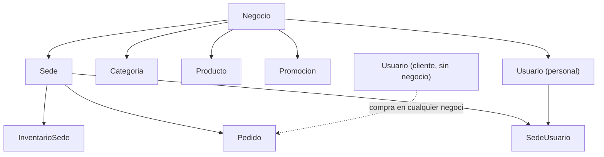
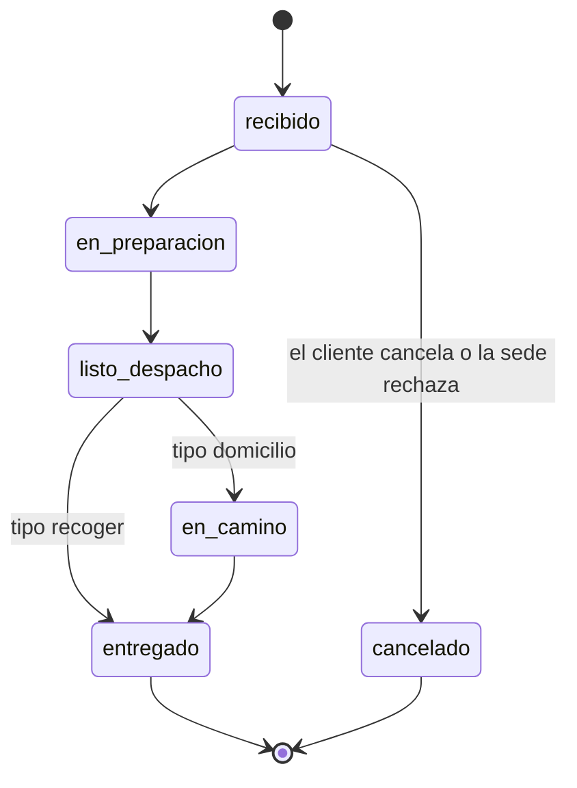

# DomiPedidosX: documentación del backend

Describe la arquitectura y los endpoints de la API REST. El código fuente está en `backend/`.

- **Stack:** Django, Django REST Framework (DRF), SimpleJWT, SQLite en local y PostgreSQL en despliegue (`DATABASE_URL`).
- **URL base:** `/api`. En local: `http://localhost:8000/api`.
- **Autenticación:** encabezado `Authorization: Bearer <access>`. El acceso por defecto exige sesión; cada vista pública lo declara con `AllowAny`.
- **Variables de entorno** (`backend/.env`): `SECRET_KEY`, `DEBUG`, `ALLOWED_HOSTS`, `CORS_ALLOWED_ORIGINS`, `DATABASE_URL`, `FRONTEND_URL` (base de los enlaces que llegan por correo; por defecto `http://localhost:5173`) y `DEFAULT_FROM_EMAIL`.

## 1. Arquitectura

### 1.1 Capas

Cada dominio es una app en `backend/apps/` con la misma división de responsabilidades.

| Archivo | Responsabilidad |
|---|---|
| `models.py` | Tablas y reglas de una sola fila (`CheckConstraint`, `UniqueConstraint`) |
| `serializers.py` | Conversión a JSON y validación de formato |
| `views.py` | Vistas `APIView` delgadas: permisos, alcance y respuesta |
| `services.py` | Lógica de negocio y transacciones (`transaction.atomic`) |
| `urls.py` | Rutas de la app |
| `tests.py` | Pruebas con `APITestCase` |

Los permisos reutilizables están en `apps/core/permissions.py`.

| App | Dominio | ¿Tiene endpoints? |
|---|---|---|
| `negocios` | Modelo `Negocio` | No; se crea con el registro de negocio y se administra en el admin de Django |
| `usuarios` | Cuentas, JWT, bloqueo de login, activación de personal, direcciones | Sí |
| `sedes` | Sedes, horarios y feriados | Sí |
| `menu` | Categorías, productos, opciones, combos | Sí |
| `inventario` | Disponibilidad y existencias por sede | Sí |
| `promociones` | Promociones con vigencia y cupo | Sí |
| `pedidos` | Pedidos, detalle e historial de estados | Sí |
| `notificaciones` | Alertas de panel (stock bajo, pedido sin repartidor), correos al cliente y su configuración por evento | Sí, la configuración de correos |
| `cobertura` | Zonas de cobertura (radio o polígono) y capacidad por franja | Sí, las zonas. La capacidad aún no |
| `repartos` | Estado de los repartidores y asignación manual o automática | Sí |
| `reportes` | Reservada | No |

### 1.2 Modelo multi-negocio (multi-tenant)

Varios restaurantes comparten la misma base de datos y la misma API. **`Negocio` es el inquilino (tenant)**: cada restaurante ve y administra solo sus datos. El aislamiento es lógico, por filas y con la columna `negocio_id`; no hay una base de datos por negocio.



Reglas del modelo:

1. **Pertenencia directa:** `Sede`, `Categoria`, `Producto`, `Promocion` y `User` tienen la clave foránea `negocio_id`.
2. **Pertenencia indirecta:** `InventarioSede`, `Pedido`, `HorarioAtencion` y `SedeUsuario` pertenecen al negocio a través de su sede.
3. **Clientes compartidos:** un cliente tiene `negocio_id = NULL`. Una misma cuenta compra en cualquier negocio, y ningún negocio administra esa cuenta.
4. **Fallo cerrado:** personal sin negocio no ve ni crea nada. `exigir_negocio` responde 403 y los filtros por `negocio_id` devuelven vacío. Esto incluye a un superusuario creado con `createsuperuser`, que solo sirve para el admin de Django.
5. **Asignación en el servidor:** el `negocio` de un recurso nuevo sale siempre de `request.user`. Nunca se acepta en el cuerpo de la petición.
6. **Sin enlaces cruzados:** los servicios rechazan relacionar recursos de negocios distintos, como un producto ajeno en un combo o en una promoción.
7. **Negocio inactivo:** con `Negocio.activo = False` sus sedes, catálogo y promociones dejan de ser públicos. Hoy este campo solo se cambia desde el admin de Django.

### 1.3 Lectura pública y gestión privada

El menú es público para que los clientes puedan navegarlo. La gestión siempre queda limitada al negocio.

| Quién consulta | Sedes, categorías y productos en listados |
|---|---|
| Anónimo o cliente | Lo activo de negocios activos. Categorías, productos y combos admiten `?negocio=<id>` |
| Personal | Solo su propio negocio |

Al consultar por id, cualquiera puede ver un producto, categoría o combo activo, porque es menú abierto. Lo inactivo solo lo ve quien lo gestiona.

### 1.4 Registro de un negocio

`POST /api/usuarios/registro-negocio/` crea el negocio y su administrador en una sola transacción: se crean ambos o ninguno. El administrador recibe `rol=admin` e `is_staff=True`, sin permisos de superusuario. La respuesta no incluye tokens, así que después se debe iniciar sesión. El negocio nace sin sedes.

## 2. Permisos

### 2.1 Clases por rol

Definidas en `apps/core/permissions.py`. Exigen usuario autenticado y activo, y comparan `request.user.rol`, leído de la base de datos. **El claim `rol` del token nunca decide el acceso.** El administrador no tiene acceso implícito: cada vista lo incluye de forma explícita.

| Clase | Rol |
|---|---|
| `EsCliente` | `cliente` |
| `EsOperador` | `operador` |
| `EsCocina` | `cocina` |
| `EsRepartidor` | `repartidor` |
| `EsAdmin` | `admin` |

Se combinan con el operador de DRF, por ejemplo `EsOperador | EsAdmin`.

### 2.2 Alcance por negocio y sede

El rol dice qué puede hacer el usuario; el alcance dice sobre qué datos.

| Función | Comportamiento |
|---|---|
| `usuario_opera_en_sede(user, sede)` | El admin opera en todas las sedes de su negocio. El resto, solo en las asignadas en `SedeUsuario` |
| `usuario_puede_gestionar_sede(user, sede)` | Igual que la anterior, pero solo para admin y operador |
| `exigir_negocio(user)` | Devuelve el negocio del usuario o responde 403 |
| `exigir_operacion_sede(user, sede)` | 403 si el usuario no trabaja en la sede |
| `exigir_gestion_sede(user, sede)` | 403 si el usuario no gestiona la sede |
| `pedidos_visibles_para(user)` | Filtra los pedidos según el rol (sección 3.4) |

`sede=None` representa un recurso de todo el negocio, y solo el admin puede operar sobre él. Por eso un operador no crea promociones globales.

### 2.3 Qué responde el acceso a recursos ajenos

| Caso | Respuesta |
|---|---|
| Sin token o token inválido | 401 |
| Rol no permitido | 403 |
| Sede ajena en inventario, pedidos o creación de promociones | 403 |
| Sede, categoría, producto, combo o promoción de otro negocio al gestionarlos | 404 |
| Usuario de otro negocio al gestionarlo | 404 |
| Pedido fuera del alcance de un repartidor | 404 |

## 3. Endpoints

La columna **Acceso** usa: *Público* (sin sesión), *Sesión* (cualquier usuario autenticado) o los roles permitidos.

### Formato de errores

| Código | Cuerpo | Cuándo |
|---|---|---|
| 400 | `{"campo": ["mensaje"]}` o `{"detail": "mensaje"}` | Validación o regla de negocio |
| 401 | `{"detail": "..."}` | Sin credenciales válidas |
| 403 | `{"detail": "..."}` | Sin permiso |
| 404 | `{"detail": "..."}` | No existe o está fuera del alcance |

### 3.1 Autenticación y usuarios

| Método | Ruta | Acceso | Descripción |
|---|---|---|---|
| POST | `/auth/login/` | Público | Inicia sesión. Devuelve `access`, `refresh` y `user` |
| POST | `/auth/refresh/` | Público | Recibe `refresh` y devuelve un `access` nuevo |
| GET | `/auth/modulo-sede/` | Operador | Vista provisional de comprobación de rol |
| GET | `/auth/modulo-cocina/` | Cocina | Vista provisional de comprobación de rol |
| GET | `/auth/modulo-repartidor/` | Repartidor | Vista provisional de comprobación de rol |
| POST | `/usuarios/login/` | Público | Alias de `/auth/login/` |
| POST | `/usuarios/registro/` | Público | Registra un cliente. No devuelve tokens |
| POST | `/usuarios/registro-negocio/` | Público | Registra un negocio y su administrador. No devuelve tokens |
| GET, PATCH | `/usuarios/me/` | Sesión | Consulta el perfil propio o edita `nombre`, `apellido` y `telefono` |
| PATCH | `/usuarios/me/desactivar/` | Cliente | El cliente desactiva su propia cuenta. Cuerpo: `{"password": "..."}` |
| POST | `/usuarios/personal/` | Admin | Crea personal del negocio, lo asigna a sus sedes y le envía el enlace de activación |
| GET | `/usuarios/activar-cuenta/{token}/` | Público | Valida el enlace de activación. Devuelve `nombre`, `email`, `rol` y `expira_en` |
| POST | `/usuarios/activar-cuenta/` | Público | Define la contraseña del personal. Cuerpo: `token`, `password`, `password_confirmacion` |
| GET | `/usuarios/usuarios/` | Admin | Lista el personal activo del negocio, con `activacion_pendiente` |
| PATCH | `/usuarios/usuarios/{id}/desactivar/` | Admin | Desactiva a un miembro del personal (`is_active=False`) |
| PATCH | `/usuarios/usuarios/{id}/cambiar-rol/` | Admin | Cambia el rol. Cuerpo: `{"rol": "..."}` |
| POST | `/usuarios/usuarios/{id}/reenviar-activacion/` | Admin | Envía un enlace nuevo e invalida el anterior |
| GET | `/usuarios/clientes/?q=` | Operador, Admin | Busca clientes para registrar pedidos a su nombre |
| POST | `/usuarios/clientes/` | Operador, Admin | Registro rápido de un cliente: `nombre`, `telefono` (10 dígitos), `apellido` y `email` opcionales |
| GET, POST | `/usuarios/direcciones/` | Sesión | Lista o crea direcciones propias, con un máximo de 5 |
| PATCH, DELETE | `/usuarios/direcciones/{id}/` | Sesión | Edita o desactiva una dirección propia |
| POST | `/usuarios/password-reset/` | Público | Envía por correo un enlace de recuperación (30 minutos). La respuesta no revela si el correo existe |
| POST | `/usuarios/password-reset/confirmar/` | Público | Cambia la contraseña. Cuerpo: `uidb64`, `token`, `new_password` |

**Inicio de sesión**

```jsonc
// POST /api/auth/login/
{ "email": "admin@negocio.com", "password": "ClaveSegura#2024" }

// 200 OK
{
  "access": "<jwt>",
  "refresh": "<jwt>",
  "user": {
    "id": "uuid",
    "nombre": "Ana",
    "apellido": "Ruiz",
    "email": "admin@negocio.com",
    "telefono": "3001112233",
    "rol": "admin",
    "negocio": { "id": "uuid", "nombre": "Pizza A" },
    "sedes": []
  }
}
```

Vigencia de los tokens: `access` 60 minutos y `refresh` 7 días.

**Bloqueo por intentos fallidos (HU-1.2)**

| Situación | Respuesta (401) |
|---|---|
| Correo inexistente o contraseña incorrecta | `"Credenciales incorrectas"` |
| 5.º intento fallido consecutivo | `"Tu cuenta está bloqueada temporalmente por demasiados intentos fallidos. Intenta de nuevo en 15 minutos."` |
| Durante el bloqueo, aunque la contraseña sea correcta | El mismo mensaje con los minutos restantes |
| Cuenta desactivada y contraseña correcta | `"Cuenta desactivada"` |

- El contador vive en `User.intentos_fallidos` y el fin del bloqueo en `User.bloqueado_hasta`.
- Un inicio de sesión exitoso, la activación de la cuenta o la recuperación de contraseña reinician ambos.
- Un correo inexistente no acumula intentos, para no revelar qué correos existen.
- Parámetros en `settings.py`: `LOGIN_MAX_INTENTOS = 5` y `LOGIN_BLOQUEO_MINUTOS = 15`.

**Recuperación de contraseña.** El correo incluye el enlace `{FRONTEND_URL}/recuperar-contrasena?uid=...&token=...`, válido 30 minutos (`PASSWORD_RESET_TIMEOUT`).

**Registro de negocio**

```jsonc
// POST /api/usuarios/registro-negocio/
{
  "negocio_nombre": "Pizza A",
  "negocio_descripcion": "Pizzas artesanales",
  "nombre": "Ana",
  "apellido": "Ruiz",
  "email": "admin@negocio.com",
  "telefono": "3001112233",
  "password": "ClaveSegura#2024",
  "password_confirmacion": "ClaveSegura#2024"
}

// 201 Created
{
  "mensaje": "Negocio registrado exitosamente",
  "id": "uuid",
  "email": "admin@negocio.com",
  "negocio": { "id": "uuid", "nombre": "Pizza A" }
}
```

**Personal por sede**

```jsonc
// POST /api/usuarios/personal/
{
  "nombre": "Luis",
  "apellido": "Mora",
  "email": "luis@negocio.com",
  "telefono": "3005556677",
  "rol": "repartidor",
  "sedes_ids": ["uuid-de-sede"]
}
```

- Roles permitidos: `operador`, `cocina`, `repartidor` y `admin`.
- **El admin no define la contraseña (HU-1.4).** La cuenta nace con una contraseña inutilizable y se envía al correo del empleado el enlace `{FRONTEND_URL}/activar-cuenta/{token}`. El token es de un solo uso, vence en 24 horas (`ACTIVACION_CUENTA_HORAS`) y en la base solo se guarda su hash (`TokenActivacion`). Si se pide uno nuevo, el anterior deja de servir.
- Operador, cocina y repartidor requieren al menos una sede activa de su negocio. El admin puede no tener sedes asignadas.
- Un usuario con rol repartidor recibe automáticamente un `PerfilRepartidor`.

**Reglas de gestión de personal**

- El admin solo gestiona usuarios de su negocio.
- Un admin no puede cambiar su propio rol ni desactivarse (400): su negocio podría quedar sin responsable.
- Al cambiar a una persona al rol `cliente`, pierde su negocio y sus sedes.
- Un negocio no gestiona cuentas de clientes. **El cliente desactiva su propia cuenta (HU-1.10)** con `PATCH /usuarios/me/desactivar/`, confirmando su contraseña. Sus pedidos, incluidos los que están en curso, y su historial se conservan; desde ese momento sus tokens dejan de servir y el login responde "Cuenta desactivada".

**Búsqueda de clientes.** Por nombre solo aparecen quienes ya compraron en ese negocio. A un cliente nuevo se le encuentra con su correo o teléfono exactos. Así un negocio no puede recorrer la base de clientes de la plataforma. Devuelve como máximo 20 resultados.

**Registro rápido de cliente (HU-5.9).** El operador crea la cuenta con nombre y teléfono para asociarle un pedido telefónico o de mostrador. El teléfono debe tener exactamente 10 dígitos y no puede repetirse entre clientes. Sin correo se guarda uno interno no entregable (`cliente-<telefono>@sin-correo.invalid`), porque el modelo exige un email único. La cuenta no tiene contraseña; si el cliente dio un correo real puede activarla con "Recuperar contraseña". Responde con el mismo formato que la búsqueda.

### 3.2 Negocios y sedes

No hay endpoints de `Negocio`: se crea con el registro público y se administra en el admin de Django.

| Método | Ruta | Acceso | Descripción |
|---|---|---|---|
| GET | `/sedes/` | Público | Sedes activas de negocios activos. El personal ve solo las de su negocio. Un admin puede pedir `?incluir_inactivas=true` |
| POST | `/sedes/` | Admin | Crea una sede en el negocio del admin |
| GET | `/sedes/{id}/` | Público | Detalle. Una sede inactiva solo la ve su admin |
| PUT, PATCH | `/sedes/{id}/` | Admin | Actualiza una sede del negocio |
| DELETE | `/sedes/{id}/` | Admin | Desactiva la sede (`activa=False`); no la borra |
| POST | `/sedes/{id}/reactivar/` | Admin | Reactiva la sede |
| GET | `/sedes/feriados/[?desde=AAAA-MM-DD]` | Admin, Operador | Feriados del negocio |
| POST | `/sedes/feriados/` | Admin | Crea un feriado. Cuerpo: `fecha`, `nombre`, `sedes_ids` (opcional) |
| GET, PUT, PATCH, DELETE | `/sedes/feriados/{id}/` | Admin | Consulta, edita o elimina un feriado del negocio |

```jsonc
// POST /api/sedes/
{
  "nombre": "Sede Norte",
  "direccion": "Calle 10 # 5-20",
  "telefono": "6025550101",
  "latitud": "3.45160000",
  "longitud": "-76.53200000",
  "horarios": [
    { "dia_semana": 1, "hora_apertura": "08:00", "hora_cierre": "20:00" }
  ]
}
```

- `dia_semana` va de 1 (lunes) a 7 (domingo), y la hora de cierre debe ser posterior a la de apertura.
- La respuesta incluye `negocio_id` y `negocio_nombre`, que el cliente usa para distinguir sedes de restaurantes distintos.
- **Los horarios se validan al pedir:** una sede sin un tramo abierto en este momento no recibe pedidos.
- `asignacion_automatica_repartidor` (booleano, por defecto `false`) activa la asignación automática de repartidores. El admin lo cambia aquí; el operador, con `PATCH /repartos/sedes/{id}/configuracion/`.

**Feriados (HU-8.9).** Un feriado pertenece al negocio. Con `sedes_ids` vacío o ausente cierra **todas** sus sedes (`aplica_a_todas: true`); con sedes, solo esas. Las sedes deben ser del mismo negocio (400 si no). Ese día, crear o cotizar un pedido en una sede afectada responde con el mensaje exacto **"Sede cerrada por feriado"**.

### 3.2.1 Zonas de cobertura

Modelo `ZonaCobertura` (app `cobertura`). Cada sede tiene una o varias zonas, definidas por radio o por polígono.

| Método | Ruta | Acceso | Descripción |
|---|---|---|---|
| GET | `/cobertura/sedes/{sede_id}/zonas/` | Admin, Operador de la sede | Zonas de la sede, activas e inactivas |
| POST | `/cobertura/sedes/{sede_id}/zonas/` | Admin | Crea una zona |
| GET, PUT, PATCH | `/cobertura/zonas/{id}/` | Admin | Consulta o edita una zona. `activa: true` la reactiva |
| DELETE | `/cobertura/zonas/{id}/` | Admin | Desactiva la zona (borrado lógico) |
| GET | `/cobertura/verificar/?lat=&lng=[&sede=]` | Público | `{ "cubierta": bool, "zonas": [...] }`: qué sedes llegan a ese punto |

```jsonc
// POST /api/cobertura/sedes/{sede_id}/zonas/  (por radio)
{
  "nombre": "Centro 3 km",
  "tipo": "radio",
  "centro_lat": "3.451600",
  "centro_lng": "-76.532000",
  "radio_km": "3",
  "tarifa_domicilio": "4000",
  "pedido_minimo": "20000",
  "tiempo_estimado_min": 35
}

// Por polígono: lista de puntos [lat, lng], mínimo 3 distintos
{ "nombre": "Cuadrante", "tipo": "poligono",
  "poligono": [[3.44, -76.54], [3.44, -76.53], [3.45, -76.53], [3.45, -76.54]],
  "tarifa_domicilio": "3000", "pedido_minimo": "0", "tiempo_estimado_min": 25 }
```

- Radio: distancia con la fórmula del haversine. Polígono: algoritmo de *ray casting*; un punto sobre el borde cuenta como cubierto.
- Al cambiar el tipo, los campos del otro tipo se limpian.
- Si varias zonas de la sede cubren el mismo punto, se usa la de menor tarifa.
- Solo cuentan zonas activas de sedes activas de negocios activos.
- La lógica está en `apps/cobertura/services.py` (`zona_para_entrega`, `zonas_que_cubren`).

### 3.3 Catálogo e inventario

#### Categorías

| Método | Ruta | Acceso | Descripción |
|---|---|---|---|
| GET | `/menu/categorias/` | Público | Categorías activas. Admite `?negocio=<id>` |
| POST | `/menu/categorias/` | Operador, Admin | Crea una categoría en el negocio |
| GET | `/menu/categorias/{id}/` | Público | Detalle. Una inactiva solo la ve quien la gestiona |
| PUT, PATCH | `/menu/categorias/{id}/` | Operador, Admin | Actualiza una categoría del negocio |
| DELETE | `/menu/categorias/{id}/` | Operador, Admin | Desactiva la categoría |

#### Productos y opciones

| Método | Ruta | Acceso | Descripción |
|---|---|---|---|
| GET | `/menu/productos/` | Público | Productos disponibles. Admite `?negocio=<id>`. El personal gestor puede pedir `?incluir_inactivos=true` |
| POST | `/menu/productos/` | Operador, Admin | Crea un producto en el negocio |
| GET | `/menu/productos/{id}/` | Público | Detalle. Uno no disponible solo lo ve quien lo gestiona |
| PUT, PATCH | `/menu/productos/{id}/` | Operador, Admin | Actualiza un producto del negocio |
| DELETE | `/menu/productos/{id}/` | Operador, Admin | Desactiva el producto (`disponible=False`) |
| GET | `/menu/productos/{id}/opciones/` | Público | Grupos de opciones del producto |
| POST | `/menu/productos/{id}/opciones/` | Operador, Admin | Crea o configura un grupo de opciones |

Campos del producto: `categoria_id`, `nombre`, `descripcion`, `precio_base`, `imagen_url`, `tiempo_preparacion_min`, `es_combo`, `disponible`. Las imágenes se guardan como URL.

#### Combos

| Método | Ruta | Acceso | Descripción |
|---|---|---|---|
| GET | `/menu/combos/` | Público | Combos disponibles. Admite `?negocio=<id>` |
| POST | `/menu/combos/` | Operador, Admin | Crea un combo con productos del mismo negocio |
| GET | `/menu/combos/{id}/` | Público | Detalle del combo y sus componentes |
| PUT, PATCH | `/menu/combos/{id}/` | Operador, Admin | Actualiza un combo del negocio |
| DELETE | `/menu/combos/{id}/` | Operador, Admin | Desactiva el combo |

#### Catálogo de una sede

| Método | Ruta | Acceso | Descripción |
|---|---|---|---|
| GET | `/menu/sedes/{sede_id}/catalogo/` | Público | Lo que realmente se vende en la sede, con el campo `agotado` |

Un producto aparece en el catálogo solo si la sede está activa, su negocio está activo, tiene fila de inventario con `disponible_en_sede=True` y el producto tiene `disponible=True`.

#### Inventario por sede

El modelo se llama `InventarioSede` (tabla `inventario_inventariosede`).

| Método | Ruta | Acceso | Descripción |
|---|---|---|---|
| GET | `/inventario/sedes/{sede_id}/` | Operador, Admin | Inventario de la sede |
| POST | `/inventario/sedes/{sede_id}/` | Operador, Admin | Crea o actualiza una fila: 201 si es nueva, 200 si ya existía |
| PUT, PATCH | `/inventario/sedes/{sede_id}/` | Operador, Admin | Actualiza la fila indicada por `producto_id` |
| DELETE | `/inventario/sedes/{sede_id}/` | Operador, Admin | Quita el producto de la sede (`producto_id` en el cuerpo o la URL) |

```jsonc
// POST /api/inventario/sedes/{sede_id}/
{
  "producto_id": "uuid",
  "disponible_en_sede": true,
  "controla_stock": true,
  "stock_actual": 20,
  "stock_minimo": 5
}
```

- **Sin fila de inventario, el producto no se vende en esa sede.**
- `agotado` y `stock_bajo` son columnas calculadas por la base de datos y de solo lectura.
- Con `controla_stock=false` no se descuentan existencias.

#### Promociones

| Método | Ruta | Acceso | Descripción |
|---|---|---|---|
| GET | `/promociones/` | Público | Promociones activas y vigentes. Con `?incluir_inactivas=true`, el personal gestor ve las de su negocio; el operador, las globales y las de sus sedes |
| POST | `/promociones/` | Operador, Admin | Crea una promoción. Sin `sede_id` es global y solo la puede crear el admin |
| GET | `/promociones/{id}/` | Público | Detalle. Una inactiva o fuera de vigencia solo la ve quien la gestiona |
| PUT, PATCH | `/promociones/{id}/` | Operador, Admin | Actualiza una promoción del negocio |
| DELETE | `/promociones/{id}/` | Operador, Admin | Desactiva la promoción |

- Exactamente un tipo de descuento: `porcentaje_descuento` o `monto_descuento`.
- `codigo` es único **dentro de cada negocio**: dos negocios pueden usar el mismo código.
- Las promociones se aplican al pedido con `codigo_promocion` o `promocion_id`. Ver [Promociones en el pedido](#promociones-en-el-pedido).

### 3.4 Pedidos y cocina

| Método | Ruta | Acceso | Descripción |
|---|---|---|---|
| GET | `/pedidos/` | Cliente, Cocina, Operador, Repartidor, Admin | Pedidos visibles para el usuario. Filtros: `sede`, `estado` y `fecha` |
| POST | `/pedidos/` | Cliente, Operador, Admin | Crea un pedido y descuenta inventario |
| POST | `/pedidos/cotizar/` | Cliente, Operador, Admin | Mismo cuerpo que crear: devuelve el desglose sin guardar nada |
| PATCH | `/pedidos/{id}/estado/` | Cocina, Operador, Repartidor, Admin | Avanza el estado. Cuerpo: `estado` y `comentario` opcional |
| POST | `/pedidos/{id}/cancelar/` | Cliente (dueño del pedido) | Cancela el pedido si está en `recibido`. Cuerpo: `motivo` opcional |
| POST | `/pedidos/{id}/rechazar/` | Operador, Admin de la sede | Rechaza un pedido entrante (`recibido`). Cuerpo: `motivo`, mínimo 10 caracteres |

`estado` admite varios valores separados por coma: `?estado=recibido,en_preparacion`.

#### Visibilidad

| Rol | Pedidos visibles |
|---|---|
| Cliente | Los suyos |
| Admin | Todos los de su negocio |
| Operador, Cocina | Los de sus sedes asignadas |
| Repartidor | Domicilios de sus sedes: los que ya lleva, más los que nadie ha tomado en `listo_despacho` o `en_camino` |

#### Crear un pedido

```jsonc
// POST /api/pedidos/
{
  "sede_id": "uuid",
  "canal": "web",
  "tipo": "domicilio",
  "metodo_pago": "efectivo",
  "direccion_entrega": "Calle 5 # 38-20",
  "entrega_lat": "3.45160000",
  "entrega_lng": "-76.53200000",
  "observaciones": "Tocar el timbre",
  "codigo_promocion": "MARTES10",
  "detalles": [
    {
      "producto_id": "uuid",
      "cantidad": 2,
      "notas_producto": "Bien asada",
      "opciones": ["uuid-de-opcion"]
    }
  ]
}
```

Reglas:

- `canal`: `web`, `telefono` o `mostrador`. `tipo`: `domicilio` o `recoger`. `metodo_pago`: `efectivo`, `tarjeta` o `transferencia` (el pago es simulado).
- Un domicilio exige `direccion_entrega`, `entrega_lat` y `entrega_lng`.
- La cantidad máxima por línea es 10.
- Cada producto debe venderse en la sede, y cada opción debe pertenecer a su producto y estar activa.
- Precios y totales se calculan en el servidor. Nombres y precios se guardan como copia, para que el historial no cambie si se edita el menú.
- **`costo_domicilio` y `descuento` no se reciben:** si vienen en la petición se ignoran.
- **Validaciones del servidor**, en este orden (el primer problema se devuelve como `{"detail": "..."}` con 400):
  0. Hoy no es feriado para la sede. Si lo es: **"Sede cerrada por feriado"**.
  1. La sede está abierta según su horario de hoy. Si no: "La sede X está cerrada en este momento. Hoy atiende de 08:00 a 20:00." o "La sede X no atiende hoy."
  2. A domicilio, el punto cae en una zona activa de la sede. Si no: **"Tu dirección está fuera de la zona de cobertura"**.
  3. A domicilio, el subtotal alcanza el `pedido_minimo` de la zona. Si no: "El pedido mínimo para tu zona (Centro) es $20.000. Te faltan $5.000."
  4. La promoción, si se envió, es válida (ver abajo).
- Al confirmar se guardan `zona`, `costo_domicilio` (la tarifa de la zona; 0 al recoger), `promocion`, `descuento` y `tiempo_estimado_entrega` (ahora + minutos de la zona, o el mayor tiempo de preparación al recoger).
- El **stock se descuenta al crear el pedido**, no al cambiar de estado. Los combos descuentan cada componente. Sin existencias suficientes responde 400 y no se guarda nada.
- Si el stock llega al mínimo, se genera una notificación de stock bajo.

Según quién crea el pedido:

| Rol | Comportamiento |
|---|---|
| Cliente | Compra siempre a su nombre: se ignora `cliente_id` |
| Operador, Admin | Solo en sedes que gestionan. Pueden enviar `cliente_id` de un cliente activo |

#### Cotizar un pedido

`POST /pedidos/cotizar/` recibe el mismo cuerpo que la creación y no guarda nada. El carrito lo usa para mostrar el desglose antes de confirmar. Los problemas de negocio no fallan la petición: se devuelven en `problemas`.

```jsonc
// 200 OK
{
  "subtotal": "30000.00",
  "descuento": "3000.00",
  "costo_domicilio": "4000.00",
  "total": "31000.00",
  "tiempo_estimado_min": 35,
  "zona": { "id": "uuid", "nombre": "Centro", "pedido_minimo": "20000.00", "tiempo_estimado_min": 35 },
  "promocion": { "id": "uuid", "nombre": "Martes 10%", "codigo": "MARTES10" },
  "error_promocion": "",
  "problemas": [],
  "puede_confirmar": true
}
```

Solo responde 400 por errores de estructura: un producto que no existe o no se vende en la sede, una opción ajena, etc.

#### Promociones en el pedido

Se envía `codigo_promocion` (sin distinguir mayúsculas) o `promocion_id`. Solo se buscan promociones del negocio de la sede. Mensajes de rechazo:

| Regla | Mensaje |
|---|---|
| No existe | "El código de promoción no existe." |
| Inactiva o de otro negocio | "La promoción no está disponible." |
| Es de otra sede | "La promoción no aplica en esta sede." |
| Antes de `fecha_inicio` / después de `fecha_fin` | "La promoción empieza el dd/mm/aaaa." / "La promoción ya no está vigente." |
| Subtotal menor que `pedido_minimo` | "La promoción requiere un pedido mínimo de $X. Te faltan $Y." |
| Tiene productos aplicables y ninguno está en el pedido | "La promoción no aplica a los productos de tu pedido." |
| Ya se usó `cupo_maximo_diario` veces hoy | "La promoción agotó su cupo de hoy." |

- El descuento se calcula sobre la suma de los productos aplicables (o todo el subtotal si la promoción no tiene productos) y nunca la supera.
- **Cupo diario:** se cuenta como los pedidos de hoy con esa promoción que no están cancelados. Cada pedido confirmado consume 1; cancelar lo libera. Al crear el pedido la fila de la promoción se bloquea (`select_for_update`) para que dos pedidos simultáneos no superen el cupo.

#### Cancelación por el cliente

`POST /pedidos/{id}/cancelar/` (HU-5.6):

- Solo el cliente dueño del pedido; para cualquier otro cliente el pedido no existe (404). El personal recibe 403.
- Solo en estado `recibido`; en otro estado responde 400 y no cambia nada.
- Pasa a `cancelado`, guarda `motivo_cancelacion` (o "Cancelado por el cliente."), **devuelve las existencias** al inventario de la sede (los combos devuelven sus componentes) y deja la fila en `HistorialEstado`.
- Las respuestas de pedidos incluyen `puede_cancelar`, `motivo_cancelacion`, `zona_nombre`, `promocion_nombre`, `repartidor_id`, `repartidor_nombre`, `esperando_repartidor` (domicilio listo sin repartidor) y `asignacion_automatica` (de la sede).

#### Aceptar o rechazar un pedido entrante (HU-6.2)

- **Aceptar** es pasarlo a cocina: `PATCH /pedidos/{id}/estado/` con `{"estado": "en_preparacion"}`.
- **Rechazar**: `POST /pedidos/{id}/rechazar/` con `{"motivo": "..."}`. El motivo es obligatorio y debe tener al menos 10 caracteres sin contar espacios a los extremos (400 si no).
- Solo el operador o el admin que gestionan la sede (403 para cocina, clientes u otras sedes) y solo en estado `recibido`.
- Hace lo mismo que la cancelación del cliente: pasa a `cancelado`, devuelve las existencias (combos expandidos), libera el cupo de la promoción y deja en `HistorialEstado` el comentario "Rechazado por la sede: <motivo>". El cliente ve el motivo en `motivo_cancelacion`.

#### Flujo de estados



| Estado | Significado |
|---|---|
| `recibido` | Pedido registrado y confirmado |
| `en_preparacion` | En cocina |
| `listo_despacho` | Listo para recoger o despachar |
| `en_camino` | El domicilio salió a entrega |
| `entregado` | Finalizado |
| `cancelado` | Cancelado por el cliente o rechazado por la sede mientras estaba en `recibido` |

- La regla vive en `estados_siguientes()`. Las respuestas incluyen `estados_siguientes`, para que el frontend no la duplique.
- Una transición inválida responde 400 y no cambia nada.
- Cada cambio deja una fila en `HistorialEstado` con su autor.
- El cambio de estado toma un bloqueo de fila (`select_for_update`).
- Cocina, operador y admin pueden hacer cualquier transición válida dentro de su alcance; la regla no distingue entre ellos.

#### Asignación de repartidores (HU-6.5 y HU-6.6)

| Método | Ruta | Acceso | Descripción |
|---|---|---|---|
| GET | `/repartos/sedes/{sede_id}/repartidores/` | Operador, Admin de la sede | Repartidores de la sede con `estado` (`disponible` u `ocupado`), `pedidos_hoy` y `pedidos_en_curso`, más `asignacion_automatica_repartidor` |
| POST | `/repartos/pedidos/{id}/asignar/` | Operador, Admin de la sede | Asignación manual. Cuerpo: `{"repartidor_id": "uuid"}` |
| PATCH | `/repartos/sedes/{sede_id}/configuracion/` | Operador, Admin de la sede | `{"asignacion_automatica_repartidor": true}`. Al activarlo se reparten de inmediato los domicilios que esperaban |

**Disponible u ocupado.** Es `PerfilRepartidor.disponible`. Un repartidor nuevo nace disponible. Queda **ocupado** al recibir un pedido (asignación manual, automática o tomándolo él mismo) y vuelve a **disponible** cuando entrega y ya no lleva ningún domicilio en `listo_despacho` o `en_camino`.

**Asignación manual.** Solo a domicilios en `listo_despacho`, y solo con repartidores activos de esa sede que estén disponibles (400 si está ocupado o es de otra sede). Reasignar libera al repartidor anterior. Queda una fila en `HistorialEstado` ("Repartidor X asignado manualmente.").

**Asignación automática.** Si la sede la tiene activa, al pasar un domicilio a `listo_despacho` se asigna al repartidor disponible de la sede con **menos pedidos en el día** (asignados o entregados, sin contar cancelados); en empate, por nombre.

- Si no hay nadie disponible, el pedido queda pendiente (`esperando_repartidor: true`) y se crea una notificación de panel `sin_repartidor` para la sede.
- Cuando un repartidor de esa sede entrega y queda libre, recibe automáticamente el pendiente más antiguo.

**El repartidor también puede tomar un pedido.** Un domicilio listo sin repartidor sigue visible para todos los repartidores de la sede, y el primero que lo pasa a `en_camino` queda a su nombre (el bloqueo de fila rechaza al segundo con 400). Un pedido ya asignado solo lo ve y lo mueve su repartidor; para los demás es 404.

Un repartidor no puede mover pedidos que siguen en cocina, ni pedidos para recoger, ni pedidos de otras sedes.

### 3.5 Correos al cliente (HU-8.10)

| Método | Ruta | Acceso | Descripción |
|---|---|---|---|
| GET, PATCH | `/notificaciones/configuracion-correos/` | Admin | Activa o desactiva cada evento para todo el negocio |

```jsonc
// GET /api/notificaciones/configuracion-correos/   (todos activados por defecto)
{ "confirmacion": true, "cambio_estado": true, "cancelacion": true,
  "asignacion_repartidor": true, "actualizado_en": "..." }
```

| Evento | Cuándo se envía |
|---|---|
| `confirmacion` | Al crear el pedido |
| `cambio_estado` | En cada avance: en preparación, listo, en camino, entregado |
| `cancelacion` | Cuando el cliente cancela o la sede rechaza (incluye el motivo) |
| `asignacion_repartidor` | Cuando el pedido recibe repartidor (manual o automático) |

- Se envían con el backend de correo de Django al **cliente del pedido**. No se envían si el pedido no tiene cliente o si el cliente fue registrado sin correo.
- Se envían al confirmar la transacción (`transaction.on_commit`): si la operación falla, no sale ningún correo.
- Cada envío queda en `Notificacion` (canal `correo`) con `estado_envio` `enviado` o `fallido`. Un fallo del correo no revierte el pedido.

## 4. Limitaciones conocidas

| Tema | Estado actual |
|---|---|
| Registro público | No verifica el correo del cliente al registrarse |
| Capacidad | Solo existe el modelo `CapacidadFranja`; no se valida al pedir (Sprint 5) |
| Correo | Se usa el backend de consola de Django; para enviar correos reales hay que configurar SMTP |
| Administración de negocios | Desactivar un negocio solo es posible desde el admin de Django |
| Documentación interactiva | No hay Swagger/OpenAPI generado; este documento es la referencia |

## 5. Pruebas

```bash
cd backend
.venv/bin/python -m pytest -q
```

Incluyen aislamiento entre negocios, permisos por rol, flujo de estados, descuento y devolución de inventario, reparto (asignación manual, automática por menor carga y liberación), rechazo con motivo, feriados, correos por evento, bloqueo de login, activación de personal, cobertura por radio y polígono, pedido mínimo, horario, promociones con cupo diario, cancelación y registro rápido de clientes.

Las pruebas que crean pedidos usan `habilitar_sede_para_pedidos(sede)` (`apps/core/datos_prueba.py`): deja la sede abierta todo el día y con una zona de 50 km alrededor del punto de prueba.
