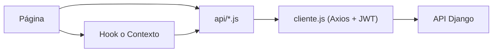
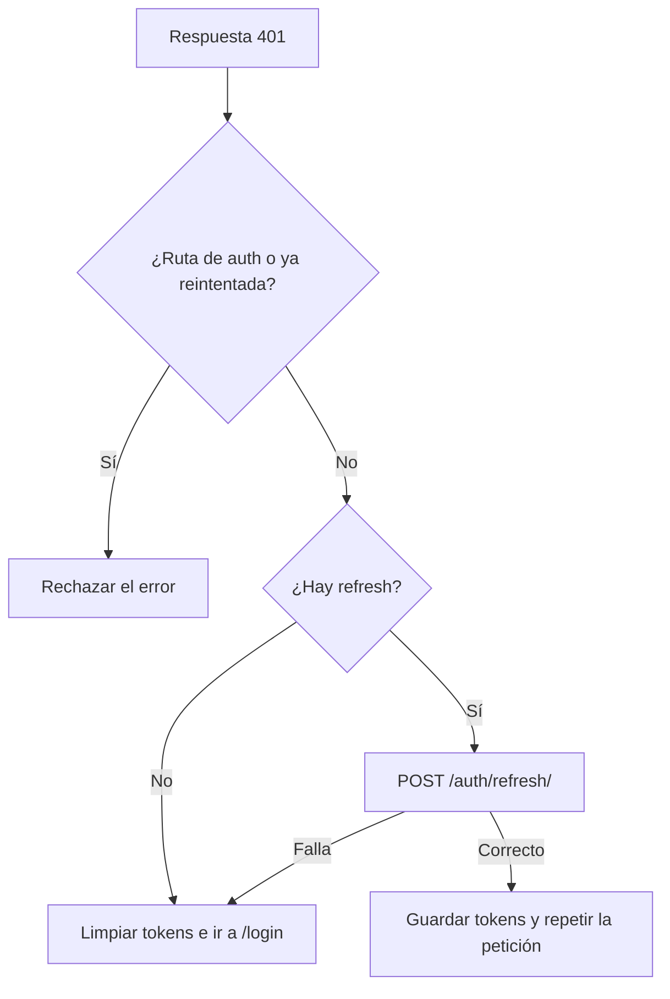
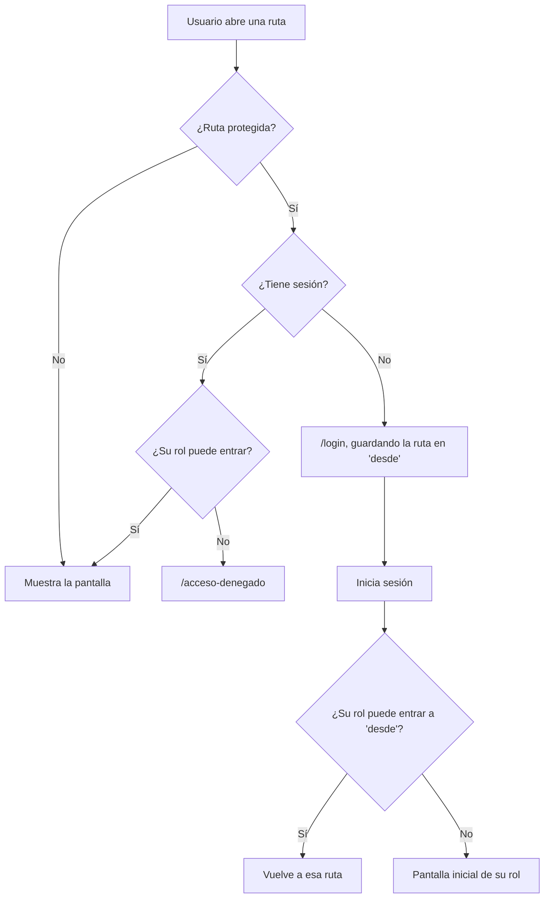
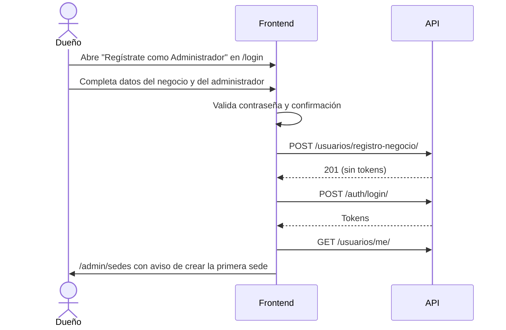
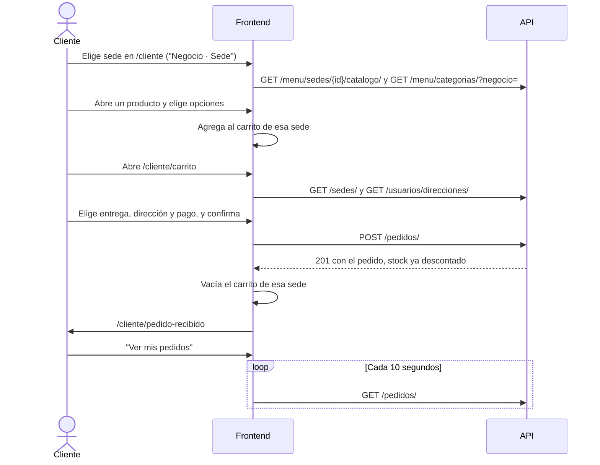
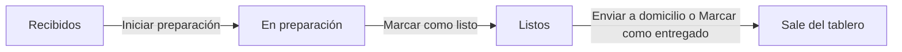

# DomiPedidosX: documentación del frontend

Describe la arquitectura, las rutas y los flujos de la aplicación web. El código fuente está en `frontend/`.

- **Stack:** React 19, Vite, Tailwind CSS 4, React Router 7, Axios; Leaflet para el mapa de direcciones.
- **Configuración:** variable `VITE_API_URL` (por defecto `http://localhost:8000`). El sufijo `/api` se agrega si falta.

```bash
cd frontend
npm install
npm run dev     # desarrollo
npm run lint    # ESLint
npm run build   # compilación
```

## 1. Arquitectura

### 1.1 Estructura

```text
frontend/src/
├── api/         Llamadas a la API, un archivo por dominio; cliente.js configura Axios
├── assets/      Imágenes y fondos
├── components/  Componentes reutilizables (Boton, CampoTexto, MensajeAlerta, ...)
├── context/     Estado global: sesión y carrito
├── data/        Datos locales de cobertura y sedes
├── hooks/       usePedidos, useSedesUsuario, useSeleccionOpciones
├── layouts/     AuthLayout, ClienteLayout, AdminLayout
├── pages/       Pantallas por actor: auth, admin, operador, cocina, repartidor, cliente
├── routes/      RutaProtegida
├── utils/       Roles, formatos, errores, carrito, validaciones
├── App.jsx      Tabla de rutas
└── main.jsx     Punto de entrada y proveedores
```

### 1.2 Flujo de datos



- Las páginas no llaman a Axios directamente: usan las funciones de `api/`.
- Reglas como las transiciones de estado vienen del backend (`estados_siguientes`) y no se duplican aquí.
- Los errores de la API se convierten en texto con `mensajeDeError` (`utils/errores.js`) y se muestran con `MensajeAlerta`.
- Los efectos que cargan datos descartan respuestas tardías con una bandera `vigente`.

### 1.3 Proveedores

`main.jsx` anida `BrowserRouter`, `AuthProvider` y `CarritoProvider`, en ese orden. El carrito depende de la sesión.

Cada contexto separa el proveedor del hook para cumplir la regla de ESLint de *fast refresh*: `AuthContext.jsx` y `auth-context.js`, `CarritoContext.jsx` y `carrito-context.js`.

### 1.4 Estilos

Tailwind CSS 4 con los colores y fuentes definidos como tokens en `@theme` (`src/index.css`), por ejemplo `bg-primario`, `text-texto` y `font-titulo`. Las pantallas del cliente están pensadas para móvil. Los paneles usan barra lateral en escritorio. El login y recuperar contraseña tienen una versión móvil y otra de escritorio que cambian en el punto `lg`.

## 2. Contextos globales

### 2.1 `AuthContext`

Se consume con `useAuth()`.

| Valor | Descripción |
|---|---|
| `usuario` | Perfil actual (`rol`, `negocio`, `sedes`, ...) o `null` |
| `cargando` | `true` mientras se restaura la sesión |
| `autenticado` | Indica si hay usuario |
| `login({ email, password })` | Guarda los tokens, carga `/usuarios/me/` y devuelve el perfil |
| `logout()` | Limpia la sesión y recarga en `/login` |
| `actualizarPerfil(datos)` | Edita el perfil con `PATCH /usuarios/me/` |

**Restaurar sesión.** Al cargar la app, si hay un `access` guardado se pide el perfil. Si falla, se borran los tokens y queda sin sesión.

**Cerrar sesión.** `logout()` hace dos cosas en orden:

1. `limpiarSesion()` borra de forma síncrona todas las claves `domipedidos.*` de `localStorage` (tokens, sede y carrito) y el encabezado `Authorization` por defecto de Axios.
2. `window.location.replace("/login")` recarga la página, lo que descarta peticiones en curso y estado en memoria.

### 2.2 `CarritoContext`

Se consume con `useCarrito()`.

| Valor | Descripción |
|---|---|
| `carritos` | Objeto `{ sedeId: [líneas] }` |
| `agregar(sedeId, linea)` | Agrega una línea |
| `cambiarCantidad(sedeId, clave, cantidad)` | Cambia la cantidad de una línea |
| `quitar(sedeId, clave)` | Quita una línea |
| `vaciar(sedeId)` | Vacía el carrito de una sede |

- **Un carrito por sede**, porque un pedido se prepara en una sola.
- **Un carrito por usuario**, guardado en `domipedidos.carrito.<id>`. Sin sesión no se guarda nada.
- El carrito sobrevive a recargar la página, pero se borra al cerrar sesión.

### 2.3 Tokens JWT en Axios

`api/cliente.js` crea la instancia de Axios.

| Clave de `localStorage` | Contenido |
|---|---|
| `domipedidos.access` | Token de acceso |
| `domipedidos.refresh` | Token de refresco |
| `domipedidos.sede` | Última sede elegida por el cliente |
| `domipedidos.carrito.<id>` | Carrito de cada usuario |

**Interceptor de petición.** Agrega `Authorization: Bearer <access>`, excepto en las rutas de login y refresh, para que un token viejo no interfiera con el ingreso de otra cuenta.

**Interceptor de respuesta.** Ante un 401:



- Varias peticiones simultáneas comparten un solo refresco (`promesaRefresco`).
- Si la sesión se cerró mientras se refrescaba, los tokens no se vuelven a guardar.
- Un 403 no se maneja aquí: cada pantalla lo muestra como error.

## 3. Rutas y redirecciones

### 3.1 Destino por rol

Definido en `INICIO_POR_ROL` (`utils/roles.js`).

| Rol | Pantalla inicial |
|---|---|
| `admin` | `/admin/usuarios` |
| `operador` | `/operador/productos` |
| `cocina` | `/cocina` |
| `repartidor` | `/repartidor` |
| `cliente` | `/cliente` |
| Sin panel propio | `/panel-no-disponible` |

### 3.2 Rutas públicas

| Ruta | Pantalla | Notas |
|---|---|---|
| `/` | | Redirige a `/login` |
| `/login` | `Login.jsx` | **Inicio de sesión principal** |
| `/iniciar-sesion` | | Redirige a `/login` |
| `/bienvenida` | `Bienvenida.jsx` | Se llega con "Regresar" desde el login móvil |
| `/registro` | `Registro.jsx` | Registro de cliente |
| `/registro-administrador` | `RegistroAdministrador.jsx` | Registro de negocio |
| `/recuperar-contrasena` | `RecuperarContrasena.jsx` | **Simulada:** aún no llama a la API |
| `/registro-restaurante` | `RegistroRestaurante.jsx` | **Maqueta:** no guarda datos y nada enlaza a ella |
| `/acceso-denegado` | `AccesoDenegado.jsx` | Ofrece volver al inicio o cerrar sesión |

### 3.3 Rutas protegidas

Los roles de cada sección están en `ROLES_POR_SECCION` (`utils/roles.js`), que usan tanto `App.jsx` como el login.

| Sección | Roles | Rutas |
|---|---|---|
| `/admin` | admin | `/admin/usuarios`, `/admin/usuarios/nueva`, `/admin/sedes`, `/admin/sedes/nueva`, `/admin/sedes/:id/editar` |
| `/operador` | operador, admin | `/operador/pedidos`, `/operador/pedidos/nuevo`, `/operador/categorias`, `/operador/productos`, `/operador/productos/nuevo`, `/operador/productos/:id/editar`, `/operador/promociones`, `/operador/promociones/nueva`, `/operador/promociones/:id/editar`, `/operador/inventario` |
| `/cocina` | cocina, operador, admin | `/cocina` |
| `/repartidor` | repartidor | `/repartidor` |
| `/cliente` | cliente | `/cliente`, `/cliente/producto/:id`, `/cliente/carrito`, `/cliente/pedido-recibido`, `/cliente/pedidos`, `/cliente/direcciones`, `/cliente/direcciones/nueva`, `/cliente/direcciones/:id/editar`, `/cliente/perfil` |
| Sin sección | Cualquier usuario con sesión | `/panel-no-disponible` |

> No existe una pantalla en `/operador`. El operador entra a `/operador/productos`, y esa ruta exacta termina redirigiendo a su panel.

### 3.4 Reglas de redirección



- Una ruta desconocida va a `/`, luego a `/login`.
- `/login` con sesión abierta lleva al panel del usuario. Por eso "Volver al inicio" y las rutas desconocidas no lo dejan en el formulario.
- `puedeEntrarA` evita la falsa alerta de "Acceso denegado" al cambiar de usuario, porque descarta una ruta guardada que pertenece a otro rol.

### 3.5 Cerrar sesión por rol

| Rol | Ubicación del botón |
|---|---|
| Admin, Operador, Cocina | Barra lateral (`BarraLateral.jsx`) |
| Repartidor | Encabezado de `/repartidor` |
| Cliente | Perfil, desde la barra inferior |
| Cualquiera | `/acceso-denegado` y `/panel-no-disponible` |

## 4. Flujos de experiencia de usuario

### 4.1 Registro de un negocio



Después el administrador configura su negocio en este orden:

1. **Crea una sede** con sus horarios en `/admin/sedes`.
2. **Crea el menú** en `/operador/categorias` y `/operador/productos`.
3. **Activa los productos en la sede** en `/operador/inventario`. Sin este paso no aparecen en el catálogo.
4. **Crea su personal** en `/admin/usuarios/nueva`, asignándolo a sus sedes.

Si el registro funciona pero falla el inicio de sesión automático, el usuario va a `/login` con un aviso. No se reintenta el registro, porque fallaría por correo repetido.

### 4.2 Compra del cliente



- **Catálogo:** los productos agotados se muestran sin opción de compra.
- **Domicilio:** exige una dirección guardada. El botón "Agregar dirección" lleva al formulario y vuelve al carrito.
- **`/cliente/pedidos`:** muestra negocio, sede, productos, total y estado. El estado se actualiza consultando cada 10 segundos, sin WebSockets.

### 4.3 Gestión del inventario por la sede

Pantalla `/operador/inventario`, para operador y admin.

1. El usuario elige una sede entre las suyas. El admin ve todas las de su negocio.
2. La pantalla combina el catálogo del negocio (`GET /menu/productos/`) con el inventario de la sede (`GET /inventario/sedes/{id}/`).
3. Por cada producto define si se vende en la sede, sus existencias y el mínimo.
4. "Guardar cambios" envía `POST /inventario/sedes/{id}/` por cada fila.

El stock baja solo al crearse un pedido. Al llegar al mínimo, el backend genera una alerta de stock bajo.

### 4.4 Tablero de comanda de cocina

Pantalla `/cocina`, para cocina, operador y admin.



- **Carga:** `usePedidos` consulta `GET /pedidos/?estado=recibido,en_preparacion,listo_despacho` cada 30 segundos.
- **Orden:** en cada columna, el pedido más antiguo aparece primero.
- **Tarjeta:** muestra hora, cliente, sede, tipo, productos, opciones, notas y observaciones.
- **Botones:** salen de `estados_siguientes`, y cada uno llama a `PATCH /pedidos/{id}/estado/`.
- **Filtro:** con más de una sede se puede filtrar por sede.
- **Sin sedes:** se muestra un aviso para pedir la asignación.

### 4.5 Pedidos del operador

- **`/operador/pedidos`:** tabla con filtros de sede, estado y fecha, y botón para avanzar cada pedido.
- **`/operador/pedidos/nuevo`:** registra pedidos por teléfono o mostrador. Busca al cliente por nombre si ya compró en el negocio, o por correo o teléfono exactos si es nuevo.

### 4.6 Entregas del repartidor

Pantalla `/repartidor`, pensada para móvil.

1. Consulta `GET /pedidos/?estado=listo_despacho,en_camino` cada 30 segundos.
2. En "Listos para despacho", **Tomar pedido y salir** lo pasa a `en_camino` y queda a su nombre.
3. En "En camino", **Marcar como entregado** finaliza el pedido.

Cada tarjeta muestra dirección, teléfono con enlace para llamar, productos, observaciones, total y forma de pago.

## 5. Limitaciones conocidas

| Tema | Estado actual |
|---|---|
| Recuperar contraseña | Simulada: muestra éxito sin cambiar nada, aunque el backend ya tiene `password-reset/` |
| `/registro-restaurante` | Maqueta sin uso; conviene retirarla o redirigirla |
| Tiempo real | Consulta periódica, no notificaciones instantáneas |
| Promociones y domicilio | No se aplican descuentos al comprar, y el costo de domicilio queda en $0 |
| Bienvenida en escritorio | Solo accesible escribiendo la URL. "Continuar con Teléfono" lleva al mismo registro con correo |
| Doble toma de un pedido | El segundo repartidor ve un error, y la tarjeta sigue visible hasta la siguiente consulta |
