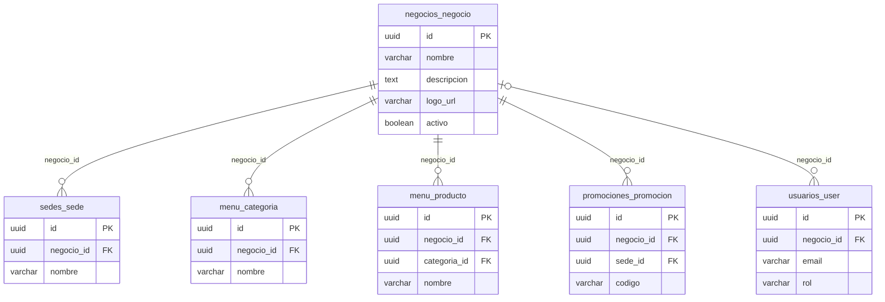
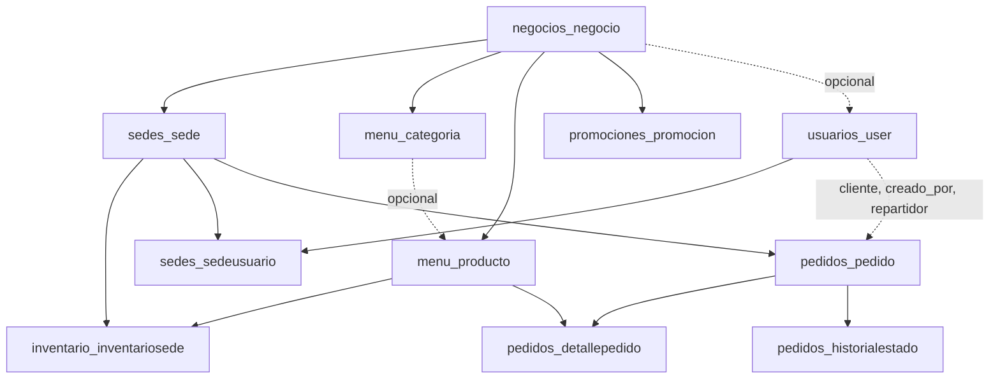

# DomiPedidosX: esquema de la base de datos

Resume el modelo multi-negocio y las relaciones con `Negocio`. La base tiene **24 tablas propias**. Se usa SQLite en local y PostgreSQL en despliegue.

| Archivo | Contenido |
|---|---|
| `domipedidosx_erd.mmd` | Diagrama entidad-relación completo (Mermaid) |
| `domipedidosx_erd_lucidchart.csv` | Importación del esquema a Lucidchart |
| `documentacion_modelo_datos.txt` | Detalle de cada tabla, atributo y regla |

## 1. La entidad `Negocio`

`Negocio` (tabla `negocios_negocio`) es el restaurante dueño de sus sedes, menú, promociones y personal. Es la raíz del aislamiento entre clientes de la plataforma (*tenants*).

| Columna | Tipo | Reglas | Descripción |
|---|---|---|---|
| `id` | UUID | Clave primaria | Identificador |
| `nombre` | varchar(150) | Obligatorio | Nombre del restaurante. No es único |
| `descripcion` | text | Opcional | Descripción |
| `logo_url` | varchar(200) | Opcional | URL del logo |
| `activo` | boolean | Por defecto `true` | Con `false`, sus datos dejan de ser públicos |
| `creado_en` | timestamp | Automático | Fecha de creación |
| `actualizado_en` | timestamp | Automático | Última modificación |

## 2. Relaciones con `negocio_id`

| Tabla | Modelo | Nulable | Al borrar el negocio | Significado |
|---|---|---|---|---|
| `sedes_sede` | `Sede` | No | `PROTECT` | Cada sede pertenece a un negocio |
| `menu_categoria` | `Categoria` | No | `PROTECT` | Cada negocio tiene sus categorías |
| `menu_producto` | `Producto` | No | `PROTECT` | Cada negocio tiene su menú |
| `promociones_promocion` | `Promocion` | No | `PROTECT` | Cada negocio tiene sus promociones |
| `usuarios_user` | `User` | **Sí** | `PROTECT` | El personal tiene negocio; el cliente, `NULL` |

`PROTECT` impide borrar un negocio que tenga datos. Para retirarlo se usa `activo = false`.

### Usuarios: por qué `negocio_id` es nulable

| Rol | `negocio_id` | Motivo |
|---|---|---|
| `admin`, `operador`, `cocina`, `repartidor` | Su negocio | Trabajan para un solo restaurante |
| `cliente` | `NULL` | Una misma cuenta compra en cualquier negocio |

La base de datos no exige esta correspondencia entre rol y negocio. La garantizan los servicios de registro y de cambio de rol.

### Tablas que pertenecen al negocio de forma indirecta

Estas tablas no tienen `negocio_id`; su negocio se obtiene por su relación con otra tabla.

| Tabla | Camino hasta el negocio |
|---|---|
| `inventario_inventariosede` | `sede_id` a `sedes_sede` |
| `pedidos_pedido` | `sede_id` a `sedes_sede` |
| `sedes_sedeusuario`, `sedes_horarioatencion` | `sede_id` a `sedes_sede` |
| `menu_grupoopcion`, `menu_productocombo` | `producto_id` o `combo_id` a `menu_producto` |
| `menu_opcionproducto` | `grupo_id` a `menu_grupoopcion` |
| `promociones_promocionproducto` | `promocion_id` a `promociones_promocion` |

### Reglas que cambian con el modelo multi-negocio

- **Código de promoción:** la restricción `uq_promo_codigo_por_negocio` lo hace único por `(negocio_id, codigo)`, y ya no en todo el sistema.
- **Relaciones entre tablas:** la base no impide, por ejemplo, un producto del negocio A en una sede del negocio B. Esa regla la aplican los servicios, porque cruza varias tablas.
- **Pedidos:** se venden solo productos con fila de inventario en la sede y del mismo negocio de la sede.

## 3. Mapa general

El diagrama completo, con las 24 tablas, está en `domipedidosx_erd.mmd`.

## 4. Migración de datos existentes

El cambio se aplicó en etapas, para no perder datos anteriores.

| Etapa | Migraciones | Qué hace |
|---|---|---|
| 1. Crear la entidad | `negocios/0001_initial` | Crea `negocios_negocio` |
| 2. Agregar la columna | `sedes/0003`, `menu/0002`, `promociones/0003`, `usuarios/0002` | Agrega `negocio_id` como opcional |
| 3. Asignar datos | `negocios/0002_asignar_datos_existentes` | Mueve lo existente a un "Negocio principal", solo si hay datos. Los clientes quedan sin negocio |
| 4. Hacerla obligatoria | `sedes/0004`, `menu/0003`, `promociones/0004` | Exige `negocio_id`, excepto en usuarios |
